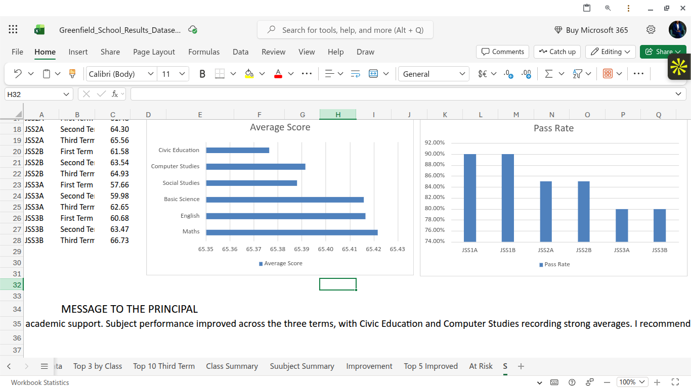

# GREENFIELD-SCHOOL-RESULT-PROJECT
---
## Project Overview
- This project involved cleaning, organizing, and analysing students' academic performance data for Greenfield School using Microsoft Excel.
The objective was to transform raw school results data into meaningful insights that would help school management understand students' academic performance, evaluate class performance, identify top-performing students, and support better academic decision-making.
The project involved data cleaning, removing duplicate records, correcting inconsistent entries, applying Excel formulas, analysing student scores, and creating a summary dashboard to present key findings.
---
## Tools Used
- Microsoft Excel
- Excel Formulas (IF, AVERAGE, COUNTIF, SUM)
- Sorting and Filtering
- Data Cleaning
- Pivot Tables
- Data Analysis and Visualisation
---
## Question Answered
- The analysis focused on answering the following questions:
1. How many students are represented in the dataset?
2. How many students are in each class?
3. What is the average academic performance of each class?
4. Which class has the highest average performance?
5. Who are the top three performing students?
6. Which students have the highest and lowest academic performance?
7. How do students perform across different subjects?
---
## DashBoard Preview

## Files in This Repository
- [Result Data Set](Greenfield_School_Results_Dataset.xlsx)
- [Summary Screenshot](Summary_Sheet.png)
- README.md
---
## Recommendation
- Use this as your README content. It communicates the business problem, the tools you used, the questions you answered, and the value of your analysis to a potential employer or recruiter.
---
## Conclusion
This project demonstrates how Microsoft Excel can be used to clean, analyse, and transform raw educational data into meaningful information.
The resulting analysis and summary dashboard provide Greenfield School management with insights into student performance, class averages, and academic strengths and weaknesses.
The project also strengthened my practical skills in data cleaning, Excel formulas, data analysis, and dashboard reporting.
9. What is the overall academic performance of the school?
10. How can the results help management identify areas requiring academic improvement?
